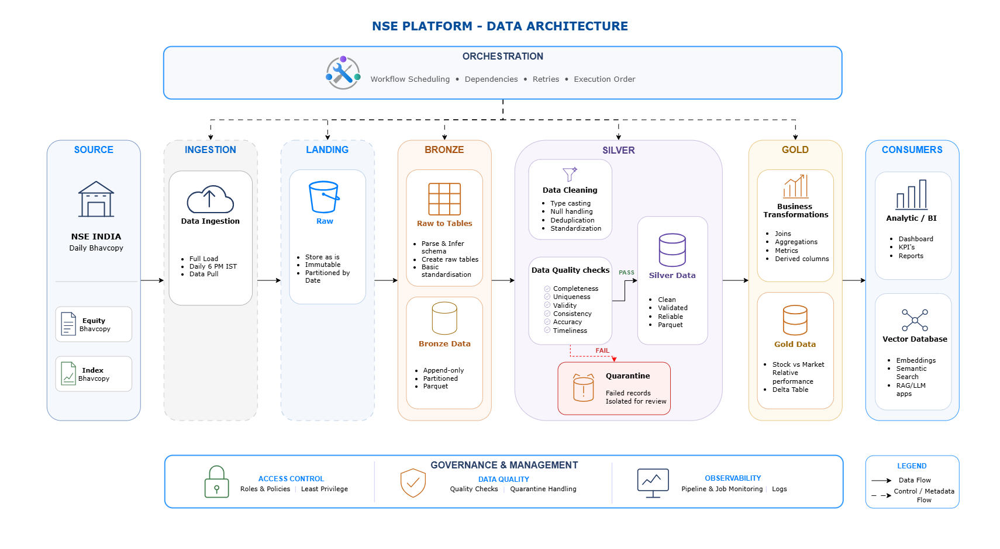

# NSE Equity Platform

Medallion lakehouse pipeline for NSE India equity and index data. Ingests daily bhavcopy files, Processes NSE data through raw, Bronze, Silver and Gold layers using PySpark, with Parquet storage in Bronze/Silver and Delta Lake for Gold and operational metadata, and computes stock-vs-market relative performance. Deployed on AWS (Lambda, Glue, S3, MWAA), orchestrated by Airflow, with CI/CD via GitHub Actions and infrastructure managed in Terraform.

## Data Architecture



## Overview

- **Source**: NSE India daily bhavcopy (equity + index)
- **Ingest**: AWS Lambda, container image
- **Storage**: S3. Raw as CSV, bronze and silver as Parquet (one partition per date), gold and operational metadata as Delta Lake.
- **Compute**: PySpark locally, AWS Glue in the cloud
- **Orchestration**: Apache Airflow - local via Docker Compose, cloud via MWAA
- **Data quality**: Contract-driven checks at the silver boundary (schema, completeness, validity, consistency, uniqueness, timeliness). Bad rows are quarantined; run-level failures stop the run. Gold has two gate checks, in code.
- **Output**: gold layer computes stock performance relative to the index

## Tech stack

| Layer         | Tools                                                           |
| ------------- | --------------------------------------------------------------- |
| Ingest        | AWS Lambda, Python                                              |
| Transform     | PySpark 4.1.2 / Delta 4.1.0 (local), Spark 3.5.6 (AWS Glue 5.1) |
| Storage       | AWS S3, local filesystem for dev                                |
| Orchestration | Apache Airflow, Amazon MWAA                                     |
| CI/CD         | GitHub Actions                                                  |
| IaC           | Terraform                                                       |
| Packaging     | `pyproject.toml`, wheel builds                                  |
| Runtime       | Python 3.12, Java 17                                            |

## Design Notes

Storage backend is switched by a single `STORAGE_BACKEND` flag and a `make_storage()` factory, the same job runs against local disk or S3 without a fork in logic. Spark jobs read/write Delta tables directly via `f"{DATA_ROOT}/{path}"` rather than through the storage abstraction, since Spark's native S3 client handles that path better than a Python-level interface built for ingest.

Ingest and transform are split into two base job classes - `BaseIngestJob` (HTTP + storage, no Spark) and `BaseSparkJob` (owns the `SparkSession`/`GlueContext`).

## Repository structure

```
├── airflow/              # DAGs,local Airflow config
├── src/nse_platform/
│   ├── jobs/
│   │   ├── base/         # BaseIngestJob,BaseSparkJob
│   │   ├── ingest/
│   │   ├── bronze/
│   │   ├── silver/
│   │   └── gold/
│   ├── storage/          # BaseStorage, local + S3
│   ├── context/          # ExecutionContext
│   ├── quality/          # contract-driven DQ checks.
│   ├── sources/          # NSE client
│   └── config/           # settings.py
├── glue_entry/           # Entrypoints Glue invokes
├── lambda_entry/         # Lambda handlers
├── scripts/              # Localrun entrypoints
├── infra/                # Terraform
├── .github/workflows/deploy.yml
└── tests/
```

## Prerequisites

- Docker + Docker Compose (local pipeline)
- Python 3.12
- AWS account + AWS CLI configured (cloud deployment only)
- Terraform >= 1.15 (cloud deployment only)

## Getting started - local

Local setup runs the full pipeline against local storage, spark in docker. Checkout the `<local-ready>` tag for the pipeline as it stood before the cloud migration, or use `main` for the current state (storage backend still switches locally via `STORAGE_BACKEND=local`).

```bash
git clone https://github.com/branesh2k/nse_data_platform.git
cd nse_data_platform
cp .env.example .env

docker compose up
```

Brings up Airflow and a local Spark environment. Trigger the DAG from the Airflow UI, or run jobs individually:

```bash
python scripts/equity/run_nse_equity_ingest.py
python scripts/equity/run_equity_bronze.py
python scripts/equity/run_equity_silver.py
python scripts/index/run_nse_index_ingest.py
python scripts/index/run_index_bronze.py
python scripts/index/run_index_silver.py
python scripts/run_stock_vs_market_gold.py
```

## Getting started - cloud (AWS)

Requires an AWS account and Terraform installed.

> `infra/backend.tf` is wired to my own AWS account (S3 bucket used for Terraform state). Update the bucket/key in `backend.tf` to your own before running `apply` against your own AWS account , otherwise this will fail on permissions, or attempt to write into my state.

```bash
cd infra
terraform init
terraform plan
terraform apply
```

Provisions S3, IAM roles, ECR, Glue jobs, and the MWAA environment (VPC, subnets, NAT gateways included).
MWAA and the NAT gateways bill hourly while they exist.

Lambda functions are created and updated by CI/CD (`.github/workflows/deploy.yml`), not Terraform - AWS requires the container image to exist in ECR before `CreateFunction` succeeds, so Lambda lifecycle is owned by the GitHub Actions pipeline on every push to `main`.

To tear down:

To stop the hourly cost, destroy only the MWAA environment, NAT gateways, EIPs and VPC using -target. Do not run a plain terraform destroy: it would also delete the S3 bucket holding the data and the Terraform state.

```bash
terraform destroy
```

## CI/CD

On push to `main`: build wheel → upload to S3 along with artifacts → build and push Lambda image to ECR → create/update Lambda functions → repoint Glue jobs to the new wheel version. Authenticates to AWS via OIDC, no stored credentials.

## Author

Branesh P - [LinkedIn](https://www.linkedin.com/in/braneshp24/) · [GitHub](https://github.com/branesh2k)
